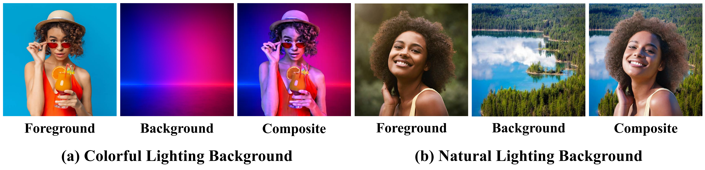
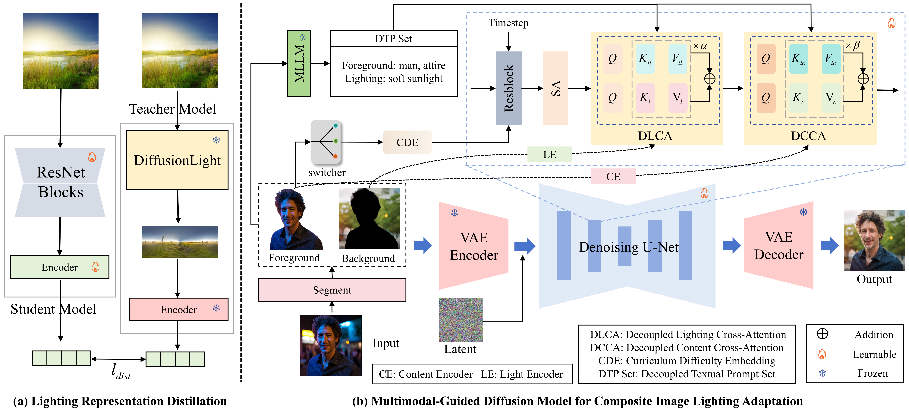

# [ACMMM 2026] Harmolight: Multimodal-Guided Diffusion Model for Composite Image Lighting Adaptation via Curriculum Lighting Learning

[](https://tandaily.github.io/Harmolight-Project/)

### Examples


### Method



## Citation

If you find this work useful, please cite:

```bibtex
@inproceedings{Liu2026HarmoLight,
  title     = {Multimodal-Guided Diffusion Model for Composite Image Lighting Adaptation via Curriculum Lighting Learning},
  author    = {Liu, Zhirui and Sun, Shang-Quan and Pei, Renjing and Li, Chaopeng and Cui, Zhigao and Song, Fenglong and Zheng, Hao and Ren, Wenqi},
  booktitle = {Proceedings of the 34th ACM International Conference on Multimedia (MM '26)},
  year      = {2026}
}
```

## Acknowledgments

This project is built upon the [IC-Light](https://github.com/lllyasviel/ic-light). 
Thanks!
